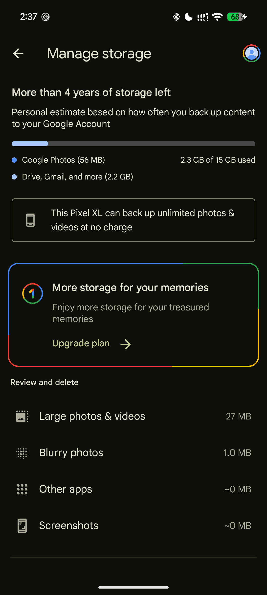
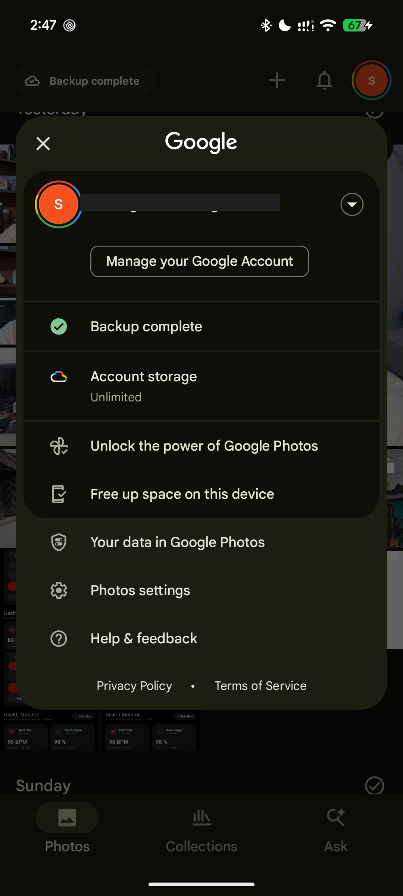

# Google Photos Unlimited — Security & Privacy Audit

[](docs/security-audit.md)
[](PRIVACY.md)
[](LICENSE)
[](https://github.com/shohagranasuvo/Google_Photos_Unlimited/releases/latest)

An open-source security research repository, privacy data-flow analysis, vulnerability remediation log, and verification guide for the modified Google Photos Android application (`app.revanced.android.photos`).

---

## 1. Project Overview & Disclaimer

This project documents defensive security research, static bytecode reverse engineering, on-device runtime analysis, and vulnerability hardening performed on a modified Google Photos client featuring Google Pixel 1 device spoofing and MicroG integration.

> [!WARNING]
> **UNOFFICIAL PROJECT & DISTRIBUTION NOTICE**:
> This repository is an independent research initiative and is **not affiliated with, maintained by, or endorsed by Google LLC or the ReVanced team**.
>
> - "Google", "Google Photos", and "Pixel" are registered trademarks of Google LLC.
> - **Why are there no pre-built APK files?** Google Photos is proprietary software. Distributing modified Google APK binaries violates copyright laws and GitHub policies. Instead, this project provides **100% legal, open-source patch tools** that let you patch your own legitimate APK in seconds!
> - **Google does not guarantee permanent unlimited storage.** Storage entitlement is enforced on Google's cloud servers based on client metadata; Google reserves the right to alter its backend policies, enforce cryptographic hardware attestation, or terminate account access at any time.

---

## 2. On-Device Storage Proofs

Below are on-device screenshots taken during verification on a Google Pixel 8, demonstrating the application interface and Google cloud storage status:

| Device Identification Banner | Account Storage Status (Redacted) |
| :---: | :---: |
|  |  |
| *"This Pixel XL can back up unlimited photos & videos at no charge"* | *"Account storage: Unlimited" (Verified Google backend response)* |

---

## 3. 🚀 Quick Setup Guide (Choose Your Method)

Choose the setup method that works best for you:

| Method | Where It Runs | PC Needed? | Ease |
| :--- | :--- | :---: | :---: |
| **[Method 1: 1-Click Patch Tool on PC](#-method-1-1-click-patch-tool-pc--mac--linux)** | Windows / Mac / Linux |  Yes | ⭐⭐⭐⭐⭐ (Fastest & Easiest) |
| **[Method 2: MT Manager / APK Editor](#-method-2-phone-only-via-mt-manager--apk-editor-no-coding)** | Directly on Android Phone | ❌ No | ⭐⭐⭐⭐⭐ (No Coding Phone GUI) |
| **[Method 3: Termux 1-Click Builder](#-method-3-phone-only-via-termux-1-click-patcher)** | Directly on Android Phone | ❌ No | ⭐⭐⭐⭐ (Fast CLI) |

---

### ⚠️ IMPORTANT: Prerequisites (MicroG & Clean APK)

#### 1️⃣ Install MicroG (Required for Google Sign-In)
Because the modified app is decoupled from official Google Play Services, it needs MicroG to log into your Google Account:
1. Download and install **MicroG GmsCore** on your phone:  
   👉 **[Download MicroG APK (Direct Link)](https://github.com/ReVanced/GmsCore/releases/latest)**
2. Open **MicroG Settings** from your app drawer:
   - Tap **Account** > **Add Google Account** and sign in.
   - Go to phone **Settings > Apps > MicroG > Battery** and set it to **Unrestricted** (so photo backups don't pause).

#### 2️⃣ Download the Clean Google Photos APK
> [!CAUTION]
> **DO NOT DOWNLOAD A "BUNDLE" (APKM)!**
> On APKMirror, look for the download row with the green **APK** badge:
> 👉 **[Download Working Google Photos APK on APKMirror](https://www.apkmirror.com/apk/google-inc/photos/google-photos-7-97-0-1003324405-release/google-photos-7-97-0-1003324405-3-android-apk-download/)**  
> *(Scroll down to "Download", click the row with the green **APK** badge, and download).*

---

### 💻 Method 1: 1-Click Patch Tool (PC / Mac / Linux)

If you have a computer, you can build the exact security-hardened APK in **5 seconds**:

1. Download the patch kit from our latest release:  
   👉 **[Download google-photos-unlimited-patch-v7.45.0.zip](https://github.com/shohagranasuvo/Google_Photos_Unlimited/releases/download/v7.45.0-remediated/google-photos-unlimited-patch-v7.45.0.zip)**
2. Extract the ZIP file on your computer.
3. Download the clean Google Photos [APK](https://www.apkmirror.com/apk/google-inc/photos/google-photos-7-97-0-1003324405-release/google-photos-7-97-0-1003324405-3-android-apk-download/) and place it in the folder as `base.apk`.
4. Run:
   ```bash
   python3 patch.py base.apk
   ```
5. Done! The script injects all security fixes, 4-byte aligns, and signs **`GooglePhotos_Unlimited_Remediated.apk`**.
6. Transfer to your phone and install!

---

### 📱 Method 2: Phone-Only via MT Manager / APK Editor (No Coding)

No computer and no coding commands needed! You can patch the app directly on your phone in **2 minutes** using a free Android APK modifier like **MT Manager** or **APK Editor**:

1. Download our patch kit and unzip it:  
   👉 **[Download google-photos-unlimited-patch-v7.45.0.zip](https://github.com/shohagranasuvo/Google_Photos_Unlimited/releases/download/v7.45.0-remediated/google-photos-unlimited-patch-v7.45.0.zip)**  
   *(Inside you will find the `payload/` folder with `AndroidManifest.xml` and `classes7.dex`).*
2. Download clean Google Photos **APK**:  
   👉 **[Google Photos APK Download (APKMirror)](https://www.apkmirror.com/apk/google-inc/photos/google-photos-7-97-0-1003324405-release/google-photos-7-97-0-1003324405-3-android-apk-download/)**
3. Download and install **MT Manager**:  
   👉 **[Download MT Manager (Official Site)](https://mt.cc)** *(or from **[APKMirror](https://www.apkmirror.com/apk/lin-jin-bin/mt-manager/)**)*
4. Open **MT Manager**:
   - On the left panel, tap `GooglePhotos.apk` and tap **View**.
   - On the right panel, open the extracted `payload/` folder.
   - Select `AndroidManifest.xml` and `classes7.dex`, then tap **Add** / **Replace** to overwrite them into the APK.
   - Inside the opened APK, delete the `META-INF/` folder to remove the old signature.
   - Go back, tap the modified APK, and tap **Function** > **Sign** (or enable Auto-sign).
5. Install the signed APK and enjoy unlimited storage!

---

### 📲 Method 3: Phone-Only via Termux (1-Click Patcher)

If you prefer a terminal command on your phone, you can build your remediated APK using **Termux** in 30 seconds:

1. Install **[Termux](https://github.com/termux/termux-app/releases/latest)** on your phone.
2. Download our patch kit:  
   👉 **[Download google-photos-unlimited-patch-v7.45.0.zip](https://github.com/shohagranasuvo/Google_Photos_Unlimited/releases/download/v7.45.0-remediated/google-photos-unlimited-patch-v7.45.0.zip)**
3. Download the clean [Google Photos APK](https://www.apkmirror.com/apk/google-inc/photos/google-photos-7-97-0-1003324405-release/google-photos-7-97-0-1003324405-3-android-apk-download/) into your phone's **Downloads** folder and name it `base.apk`.
4. Open Termux and run these commands:
   ```bash
   termux-setup-storage
   pkg update && pkg install python -y
   cd ~/storage/downloads
   unzip google-photos-unlimited-patch-v7.45.0.zip
   python patch.py base.apk
   ```
5. Done! The patched APK **`GooglePhotos_Unlimited_Remediated.apk`** will appear in your Downloads folder. Tap it in your phone's file manager to install!

---

### ✉️ Can't Do It or Having Trouble? Get the Link Directly!

If you find any of these steps difficult or can't patch it yourself, feel free to reach out to me! Send me an email and I will happily send you the direct download link:

> [!TIP]
> **Can't build it yourself? Request the link:**  
> 📧 Email: **[shohagsuvo917@gmail.com](mailto:shohagsuvo917@gmail.com?subject=Google%20Photos%20Unlimited%20APK%20Link%20Request&body=Hi%20Shohag%2C%0A%0AI%20am%20having%20trouble%20patching%20the%20app.%20Could%20you%20please%20send%20me%20the%20direct%20download%20link%20for%20the%20Google%20Photos%20Unlimited%20APK%3F%0A%0AThank%20you!)**  
> 
> 📨 **[👉 Click Here to Send an Email for the Direct Link](mailto:shohagsuvo917@gmail.com?subject=Google%20Photos%20Unlimited%20APK%20Link%20Request&body=Hi%20Shohag%2C%0A%0AI%20am%20having%20trouble%20patching%20the%20app.%20Could%20you%20please%20send%20me%20the%20direct%20download%20link%20for%20the%20Google%20Photos%20Unlimited%20APK%3F%0A%0AThank%20you!)**

---

### 🎉 How to Confirm It Works:
1. Open your newly installed **Google Photos** app.
2. Sign in with your Google account via MicroG.
3. Tap your profile picture at the top right > tap **Manage storage**.
4. You will see the official Pixel banner:  
   **"📱 This Pixel XL can back up unlimited photos & videos at no charge"**

---

## 4. Privacy-First Statement & Data Safety

> [!IMPORTANT]
> **No unauthorized data transmission was observed in the tested scenarios. This is not proof that no such transmission can occur under all conditions.**

- **Intended Media Upload**: Cloud backup requires transferring your chosen photos, videos, and EXIF metadata to Google LLC's servers (`photos.googleapis.com`, `photos-pa.googleapis.com`).
- **No Third-Party Trackers**: Static scanning across all 16 DEX files confirmed the total absence of commercial tracking and ad SDKs (no Facebook Graph, AppsFlyer, Adjust, Kochava, or Flurry).
- **Socket Verification**: Real-time Linux kernel socket monitoring confirmed that all active network connections from the app route exclusively to Google LLC (`AS15169`) over TLS (Port 443).
- **Authentication**: Google account sign-in is handled locally through the open-source MicroG GmsCore provider (`app.revanced.android.gms`), connecting to `oauth2.googleapis.com`.

For full disclosures, see [**PRIVACY.md**](PRIVACY.md) and [**docs/privacy-and-data-flow.md**](docs/privacy-and-data-flow.md).

---

## 5. Security Audit & Remediation Status

| ID | Issue | Baseline State | Remediated State | Status |
| :--- | :--- | :--- | :--- | :--- |
| **SEC-01** | Cleartext Network Policy | `usesCleartextTraffic="true"` | `usesCleartextTraffic="false"` (TLS enforced) | **MITIGATED** |
| **SEC-02** | Backup & Snapshot Restore | `allowBackup="true"`, `restoreAnyVersion="true"` | Attributes disabled to prevent ADB dump | **MITIGATED** |
| **SEC-03** | IPC Content Provider Exposure | `FreeUpSpace` & `Partner` providers exported | Set to `exported="false"` (Sandbox isolated) | **MITIGATED** |
| **SEC-04** | Startup Information Leakage | Verbose debug logging on uninitialized boot | Defaulted to silent mode in `Logger.smali` | **MITIGATED** |
| **SEC-05** | MicroG GmsCore Architecture | External Binder IPC trust boundary | Sandboxed via Android package manager | **VERIFIED** |

Read the full technical report in [**docs/security-audit.md**](docs/security-audit.md).

---

## 6. Known Issues & Troubleshooting

### "Manage Google Account" Crash (Known Issue)
- **Symptom**: Tapping the profile picture and selecting *"Manage your Google Account"* terminates the application immediately.
- **Root Cause**: The app attempts to launch `Intent { act=app.revanced.android.gms.accountsettings.action.VIEW_SETTINGS pkg=app.revanced.android.gms }`. Because MicroG does not implement this activity, Android throws an unhandled `ActivityNotFoundException`.
- **Workaround**: Manage your Google account directly in any web browser at [https://myaccount.google.com/](https://myaccount.google.com/).
- **Smali Fix**: A minimal defensive patch wrapping `startActivityForResult` in `bfcn.smali` is documented in [**docs/troubleshooting.md**](docs/troubleshooting.md).

### Sideloading Permission
- If prompted with *"Your phone is not allowed to install unknown apps"*, temporarily enable **Allow from this source**, install the app, and then immediately turn that permission back **OFF** in Android Settings.

---

## 7. Limitations & Testing Scope

- **Encrypted Payload Boundaries**: Live decrypted inspection of gRPC Protobuf byte streams was not performed due to certificate pinning and non-invasive testing rules.
- **MicroG Independence**: MicroG is maintained independently; security depends on installing verified upstream builds.
- **No In-Place Upgrades with Different Keys**: Installing builds signed with different keys requires a full reinstall.

Read more in [**docs/limitations.md**](docs/limitations.md).

---

## 8. Repository Navigation

- [**SECURITY.md**](SECURITY.md) — Responsible disclosure policy and reporting guidelines.
- [**PRIVACY.md**](PRIVACY.md) — Privacy disclosures, data flow mapping, and telemetry analysis.
- [**CHANGELOG.md**](CHANGELOG.md) — Version history and remediation logs.
- [**docs/installation.md**](docs/installation.md) — Detailed installation and sideloading guide.
- [**docs/microg-setup.md**](docs/microg-setup.md) — MicroG installation and battery setup.
- [**reports/**](reports/) — Raw audit logs, smali analyses, and test checklists.
- [**scripts/**](scripts/) — Verification and integrity test scripts.
- [**releases/**](releases/) — Release policies and patch downloads.

---

## 9. Credits & Attribution

- [Google Photos](https://photos.google.com/) by Google LLC.
- [ReVanced Team](https://github.com/ReVanced) for open-source patch components.
- [MicroG Project](https://github.com/microg) for the open-source GmsCore implementation.
