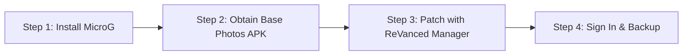

# Google Photos Unlimited — Security & Privacy Audit

[](docs/security-audit.md)
[](PRIVACY.md)
[](LICENSE)

An open-source security research repository, privacy data-flow analysis, vulnerability remediation log, and verification guide for the modified Google Photos Android application (`app.revanced.android.photos`).

---

## 1. Project Overview & Disclaimer

This project documents defensive security research, static bytecode reverse engineering, on-device runtime analysis, and vulnerability hardening performed on a modified Google Photos client featuring Google Pixel 1 device spoofing and MicroG integration.

> [!WARNING]
> **UNOFFICIAL PROJECT & DISTRIBUTION DISCLAIMER**:
> This repository is an independent research initiative and is **not affiliated with, maintained by, or endorsed by Google LLC or the ReVanced team**.
>
> - "Google", "Google Photos", and "Pixel" are registered trademarks of Google LLC.
> - **Why are there no pre-compiled APK files in GitHub Releases?** Google Photos is proprietary copyrighted software. Distributing modified Google APK binaries publicly violates copyright laws, Android terms of service, and GitHub's Acceptable Use Policies, which risks immediate DMCA takedowns and account suspension. Pre-built APKs from unknown online sources also pose severe security and malware risks to users.
> - Following standard open-source security practices (such as the ReVanced model), users obtain their own clean base APK and patch it locally using verified tools.
> - **Google does not guarantee permanent unlimited storage for modified clients.** Storage entitlement is enforced on Google's cloud servers based on client metadata; Google reserves the right to alter its backend policies, enforce cryptographic hardware attestation, or terminate account access at any time.

---

## 2. On-Device Storage Proofs

Below are on-device screenshots taken during verification on a Google Pixel 8, demonstrating the application interface and Google cloud storage status:

| Device Identification Banner | Account Storage Status (Redacted) |
| :---: | :---: |
|  |  |
| *"This Pixel XL can back up unlimited photos & videos at no charge"* | *"Account storage: Unlimited" (Verified Google backend response)* |

---

## 3. Quick Setup Guide (Step-by-Step for Users)

Follow these simple steps to set up the application on your Android device:



### Step 1: Install MicroG (Required for Account Sign-In)
Because the modified app is decoupled from official Google Play Services, it needs MicroG to log into your Google Account:
1. Download **ReVanced GmsCore** (`app.revanced.android.gms`) from the official release page:
   👉 **[ReVanced GmsCore Releases](https://github.com/ReVanced/GmsCore/releases)**
2. Install the GmsCore APK on your phone.
3. Open **MicroG Settings** from your app drawer > Tap **Account** > Add your Google Account.
4. Set Battery usage for MicroG to **Unrestricted** in Android Settings so background backups are not killed.

### Step 2: Obtain the Clean Base Google Photos APK
1. Download the target Google Photos APK (Version `7.45.0.807274941` or recommended version in ReVanced) from a trusted APK archive (such as APKMirror) or extract it from your device using ADB:
   ```bash
   adb shell pm path com.google.android.apps.photos
   adb pull <path-from-above> base.apk
   ```

### Step 3: Patch Locally Using ReVanced Manager (Easiest Method)
1. Download and install **ReVanced Manager** from the official site:
   👉 **[ReVanced Manager](https://github.com/ReVanced/revanced-manager/releases)**
2. Open ReVanced Manager > Tap **Patcher**.
3. Select **Google Photos** (choose the downloaded base APK from storage).
4. Ensure the following patches are enabled:
   - `GmsCore Support` (enables MicroG login)
   - `Spoof device` / `Unlimited storage` (spoofs Pixel 1 identity)
5. Tap **Patch** and wait 1–2 minutes.
6. Tap **Install** or save the exported APK as `Photos.apk`.

### Step 4: Verify and Start Using
1. Open the patched **Google Photos** app.
2. Sign in with your Google account via MicroG.
3. Tap your profile picture > tap **Manage storage**.
4. Confirm that the banner reads: *"This Pixel XL can back up unlimited photos & videos at no charge"*.

---

## 4. Privacy-First Statement & Data Safety

> [!IMPORTANT]
> **No unauthorized data transmission was observed in the tested scenarios. This is not proof that no such transmission can occur under all conditions.**

- **Intended Media Upload**: Cloud backup requires transferring your chosen photos, videos, and EXIF metadata to Google LLC's servers (`photos.googleapis.com`, `photos-pa.googleapis.com`).
- **No Third-Party Trackers**: Static scanning across all 16 DEX files confirmed the total absence of commercial tracking and ad SDKs (no Facebook Graph, AppsFlyer, Adjust, Kochava, or Flurry).
- **Socket Verification**: Real-time Linux kernel socket monitoring confirmed that all active network connections from the app route exclusively to Google LLC (`AS15169`) over TLS (Port 443).
- **Authentication**: Google account sign-in is handled locally through the open-source MicroG GmsCore provider (`app.revanced.android.gms`), connecting to `oauth2.googleapis.com`.

For full disclosures, see [**PRIVACY.md**](PRIVACY.md) and [**docs/privacy-and-data-flow.md**](docs/privacy-and-data-flow.md).

---

## 5. Tested Environment & Compatibility

- **Physical Device**: Google Pixel 8 (`arm64-v8a`)
- **Android Version**: Android 14, 15, and Android 17 (Developer Preview / API Level 37)
- **Application Version**: `7.45.0.807274941` (`versionCode: 50709986`)
- **Package Name**: `app.revanced.android.photos`
- **Companion Dependency**: MicroG GmsCore (`app.revanced.android.gms`)

---

## 6. Security Audit & Remediation Status

| ID | Issue | Baseline State | Remediated State | Status |
| :--- | :--- | :--- | :--- | :--- |
| **SEC-01** | Cleartext Network Policy | `usesCleartextTraffic="true"` | `usesCleartextTraffic="false"` (TLS enforced) | **MITIGATED** |
| **SEC-02** | Backup & Snapshot Restore | `allowBackup="true"`, `restoreAnyVersion="true"` | Attributes disabled to prevent ADB dump | **MITIGATED** |
| **SEC-03** | IPC Content Provider Exposure | `FreeUpSpace` & `Partner` providers exported | Set to `exported="false"` (Sandbox isolated) | **MITIGATED** |
| **SEC-04** | Startup Information Leakage | Verbose debug logging on uninitialized boot | Defaulted to silent mode in `Logger.smali` | **MITIGATED** |
| **SEC-05** | MicroG GmsCore Architecture | External Binder IPC trust boundary | Sandboxed via Android package manager | **VERIFIED** |

Read the full technical report in [**docs/security-audit.md**](docs/security-audit.md).

---

## 7. APK Integrity Verification (For Advanced Users)

If building manually on PC, verify the cryptographic hash of your built APK before installing:
```bash
./scripts/verification/verify_apk_integrity.sh path/to/your/Photos.apk
```

To install directly via ADB:
```bash
adb install -r path/to/your/Photos.apk
```

Detailed walkthrough: [**docs/installation.md**](docs/installation.md).

---

## 8. Known Issues & Troubleshooting

### "Manage Google Account" Crash (Known Issue)
- **Symptom**: Tapping the profile picture and selecting *"Manage your Google Account"* terminates the application immediately.
- **Root Cause**: The app attempts to launch `Intent { act=app.revanced.android.gms.accountsettings.action.VIEW_SETTINGS pkg=app.revanced.android.gms }`. Because MicroG does not implement this activity, Android throws an unhandled `ActivityNotFoundException`.
- **Workaround**: Manage your Google account directly in any web browser at [https://myaccount.google.com/](https://myaccount.google.com/).
- **Smali Fix**: A minimal defensive patch wrapping `startActivityForResult` in `bfcn.smali` is documented in [**docs/troubleshooting.md**](docs/troubleshooting.md).

### Sideloading Permission
- If prompted with *"Your phone is not allowed to install unknown apps"*, temporarily enable **Allow from this source**, install the app, and then immediately turn that permission back **OFF** in Android Settings.

---

## 9. Limitations & Testing Scope

- **Encrypted Payload Boundaries**: Live decrypted inspection of gRPC Protobuf byte streams was not performed due to certificate pinning and non-invasive testing rules.
- **MicroG Independence**: MicroG is maintained independently; security depends on installing verified upstream builds.
- **No In-Place Upgrades with Different Keys**: Installing builds signed with different keys requires a full reinstall.

Read more in [**docs/limitations.md**](docs/limitations.md).

---

## 10. Repository Navigation

- [**SECURITY.md**](SECURITY.md) — Responsible disclosure policy and reporting guidelines.
- [**PRIVACY.md**](PRIVACY.md) — Privacy disclosures, data flow mapping, and telemetry analysis.
- [**CHANGELOG.md**](CHANGELOG.md) — Version history and remediation logs.
- [**docs/**](docs/) — Comprehensive technical guides (Installation, MicroG, Security, Troubleshooting).
- [**reports/**](reports/) — Raw audit logs, smali analyses, and test checklists.
- [**scripts/**](scripts/) — Verification and integrity test scripts.
- [**releases/**](releases/) — Release policies and artifact verification hashes.

---

## 11. Credits & Attribution

- [Google Photos](https://photos.google.com/) by Google LLC.
- [ReVanced Team](https://github.com/ReVanced) for open-source patch components.
- [MicroG Project](https://github.com/microg) for the open-source GmsCore implementation.
