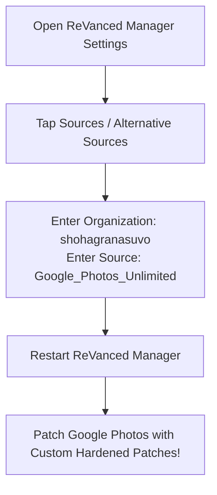

# 🔌 Using Custom Patch Source in ReVanced Manager (Option C)

You can link **ReVanced Manager** directly to this repository so it downloads and applies these security-hardened patches automatically right on your phone!

---

## ⚡ How to Add Custom Source (Takes 1 Minute)

### Step 1: Open ReVanced Manager Settings
1. Open **ReVanced Manager** on your Android device.
2. Tap the **Settings (gear icon)** in the top right or bottom navigation bar.

### Step 2: Open "Sources" or "Alternative Sources"
1. Scroll down to the **Sources** (or **Alternative Sources**) section.
2. You will see configuration fields for **Patches**:
   - **Patches organization**: Change from `revanced` to `shohagranasuvo`
   - **Patches source**: Change from `revanced-patches` to `Google_Photos_Unlimited`
3. Tap **OK** / **Save**.

### Step 3: Restart ReVanced Manager
1. Close and swipe away ReVanced Manager from your recent apps.
2. Re-open ReVanced Manager.
3. It will now fetch `patches.json` and `patches.rvp` directly from:  
   `https://github.com/shohagranasuvo/Google_Photos_Unlimited/releases/latest`

### Step 4: Patch Google Photos
1. Tap **Patcher** > select **Google Photos**.
2. You will now see the custom patches:
   - ✅ **Unlimited Storage & Pixel 1 Spoof**
   - ✅ **Security & Privacy Hardening** (SEC-01 to SEC-04)
   - ✅ **Manage Google Crash Fix**
3. Tap **Patch** and install!

---

## 🔄 How to Revert to Default ReVanced Sources
If you ever want to reset back to the default ReVanced sources:
1. Go back to **Settings > Sources**.
2. Tap the **Reset to default** button or re-enter:
   - Organization: `revanced`
   - Source: `revanced-patches`
