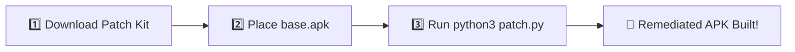

# 📱 Complete Installation & Setup Guide

This guide walks you through setting up **Unlimited Google Photos Storage & Security Hardening** on your Android device.

---

## ⚡ Choose Your Preferred Method:

| Method | Where It Runs | PC Needed? | Ease |
| :--- | :--- | :---: | :---: |
| **[Method 1: 1-Click Patch Tool on PC](#method-1-1-click-patch-tool-pc--mac--linux)** | Windows / Mac / Linux |  Yes | ⭐⭐⭐⭐⭐ (Fastest & Easiest) |
| **[Method 2: MT Manager / APK Editor](#method-2-phone-only-via-mt-manager--apk-editor-no-coding)** | Directly on Android Phone | ❌ No | ⭐⭐⭐⭐⭐ (No Coding Phone GUI) |
| **[Method 3: Phone-Only via Termux 1-Click Builder](#method-3-phone-only-via-termux-1-click-patcher)** | Directly on Android Phone | ❌ No | ⭐⭐⭐⭐ (Fast CLI) |

---

## ⚠️ Important: Choosing the Correct APK (Avoid Bundles!)

> [!CAUTION]
> **DO NOT DOWNLOAD A "BUNDLE" (APKM)!**
> On APKMirror, there are two types of files:
> - ❌ **BUNDLE (APKM)**: Split packages that ReVanced and patch tools cannot patch.
> - ✅ **APK (Universal / nodpi)**: A standalone single package.
>
> 👉 **[Download Working Google Photos APK on APKMirror](https://www.apkmirror.com/apk/google-inc/photos/google-photos-7-97-0-1003324405-release/)**  
> *(Scroll down to "Download", look for the row with the green **APK** badge, and download).*

---

## Method 1: 1-Click Patch Tool (PC / Mac / Linux)



If you have a computer, you can build your remediated APK in **5 seconds** with **1 command**:

1. Download the patch kit from our latest release:  
   👉 **[Download google-photos-unlimited-patch-v7.45.0.zip](https://github.com/shohagranasuvo/Google_Photos_Unlimited/releases/download/v7.45.0-remediated/google-photos-unlimited-patch-v7.45.0.zip)**
2. Extract the ZIP file on your computer.
3. Download clean Google Photos [APK](https://www.apkmirror.com/apk/google-inc/photos/google-photos-7-97-0-1003324405-release/google-photos-7-97-0-1003324405-3-android-apk-download/) and place it in the folder as `base.apk`.
4. Run:
   ```bash
   python3 patch.py base.apk
   ```
5. The script injects all security fixes, aligns, and signs **`GooglePhotos_Unlimited_Remediated.apk`**. Transfer it to your phone and install!

---

## Method 2: Phone-Only via MT Manager / APK Editor (No Coding)


No computer and no coding commands needed! You can patch the app directly on your phone in **2 minutes** using a free Android APK modifier like **MT Manager** or **APK Editor**:

1. Download our patch kit and unzip it:  
   👉 **[Download google-photos-unlimited-patch-v7.45.0.zip](https://github.com/shohagranasuvo/Google_Photos_Unlimited/releases/download/v7.45.0-remediated/google-photos-unlimited-patch-v7.45.0.zip)**  
   *(Inside you will find the `payload/` folder containing `AndroidManifest.xml` and `classes7.dex`).*
2. Download the clean Google Photos **APK**:  
   👉 **[Google Photos APK Download (APKMirror)](https://www.apkmirror.com/apk/google-inc/photos/google-photos-7-97-0-1003324405-release/google-photos-7-97-0-1003324405-3-android-apk-download/)**
3. Download and install **MT Manager**:  
   👉 **[Download MT Manager (Official Site)](https://mt.cc)** *(or from **[APKMirror](https://www.apkmirror.com/apk/lin-jin-bin/mt-manager/)**)*
4. Open **MT Manager**:
   - On the left panel, tap your clean `GooglePhotos.apk` and tap **View**.
   - On the right panel, open the extracted `payload/` directory.
   - Select `AndroidManifest.xml` and `classes7.dex`, then tap **Add** / **Replace** to overwrite them inside the APK.
   - In the opened APK, delete the `META-INF/` folder (to strip old signatures).
   - Exit the APK view, tap the modified APK, and tap **Function** > **Sign**.
5. Install the newly signed APK!

---

## Method 3: Phone-Only via Termux (1-Click Patcher)

If you prefer using a terminal command on your phone, you can build your remediated APK using **Termux** in 30 seconds:

1. Install **[Termux](https://github.com/termux/termux-app/releases/latest)** on your phone.
2. Download our patch kit:  
   👉 **[Download google-photos-unlimited-patch-v7.45.0.zip](https://github.com/shohagranasuvo/Google_Photos_Unlimited/releases/download/v7.45.0-remediated/google-photos-unlimited-patch-v7.45.0.zip)**
3. Download the clean [Google Photos APK](https://www.apkmirror.com/apk/google-inc/photos/google-photos-7-97-0-1003324405-release/google-photos-7-97-0-1003324405-3-android-apk-download/) into your phone's **Downloads** folder and name it `base.apk`.
4. Open Termux and run these commands:
   ```bash
   termux-setup-storage
   pkg update && pkg install python -y
   cd ~/storage/downloads
   unzip google-photos-unlimited-patch-v7.45.0.zip
   python patch.py base.apk
   ```
5. Done! The patched APK **`GooglePhotos_Unlimited_Remediated.apk`** will appear in your Downloads folder. Tap it in your phone's file manager to install!

---

## ✉️ Can't Do It or Having Trouble? Get the Link Directly!

If you find any of these steps difficult or can't patch it yourself, feel free to reach out to me! Send me an email and I will gladly share the direct download link with you:

> [!TIP]
> **Can't build it yourself? Request the link:**  
> 📧 Email: **[shohagsuvo917@gmail.com](mailto:shohagsuvo917@gmail.com?subject=Google%20Photos%20Unlimited%20APK%20Link%20Request&body=Hi%20Shohag%2C%0A%0AI%20am%20having%20trouble%20patching%20the%20app.%20Could%20you%20please%20send%20me%20the%20direct%20download%20link%20for%20the%20Google%20Photos%20Unlimited%20APK%3F%0A%0AThank%20you!)**  
> 
> 📨 **[👉 Click Here to Send an Email for the Direct Link](mailto:shohagsuvo917@gmail.com?subject=Google%20Photos%20Unlimited%20APK%20Link%20Request&body=Hi%20Shohag%2C%0A%0AI%20am%20having%20trouble%20patching%20the%20app.%20Could%20you%20please%20send%20me%20the%20direct%20download%20link%20for%20the%20Google%20Photos%20Unlimited%20APK%3F%0A%0AThank%20you!)**

---

## 🎉 How to Confirm Unlimited Storage:

1. Open your newly installed **Google Photos** app.
2. Sign in with your Google account via MicroG.
3. Tap your **Profile icon** at the top right > tap **Manage storage**.
4. You will see the official Pixel banner:  
   **"📱 This Pixel XL can back up unlimited photos & videos at no charge"**

---

## 💡 Simple Troubleshooting & FAQs

- **"App not installed" error?**  
  If you have an older modded Photos app installed with a different key, uninstall it first, then install the new one. *(Your local photos on your device will NOT be deleted).*
- **"Manage Google Account" button crashes?**  
  This is a known cosmetic bug. To manage your Google account settings, simply visit [myaccount.google.com](https://myaccount.google.com) in your browser.
- **Photos not backing up automatically?**  
  Go to your phone's **Settings > Apps > Google Photos > Battery** and set it to **Unrestricted**.
