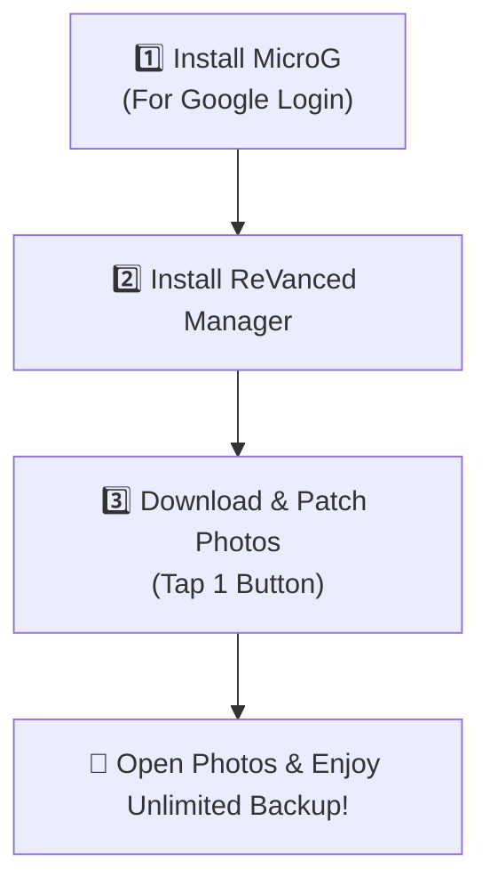

# 📱 Easy Setup & Installation Guide (No PC Needed)

Get **Unlimited Google Photos Storage** on your Android phone in **3 simple steps**. You do **not** need a computer, root access, or technical skills!

---

## ⚡ Quick 3-Step Phone Setup (Takes 3 Minutes)



---

### Step 1: Install MicroG (For Google Sign-In)

Because this app works without root, it uses **MicroG** to securely log into your Google Account.

1. On your phone, tap this link to download the latest MicroG:  
   👉 **[Download MicroG APK (Direct Link)](https://github.com/ReVanced/GmsCore/releases/latest)**
2. Tap the downloaded file in your browser or **Downloads** folder to install it.  
   *(If prompted "Allow from this source", tap **Settings** and turn it **ON**).*
3. Open **MicroG Settings** from your app drawer:
   - Tap **Account** > **Add Google Account**.
   - Log into your Google Account.
   - Go to phone **Settings > Apps > MicroG > Battery** and select **Unrestricted** (so backups run in the background).

---

### Step 2: Install ReVanced Manager

ReVanced Manager patches the app automatically on your phone with one tap.

1. Download the official ReVanced Manager:  
   👉 **[Download ReVanced Manager APK](https://github.com/ReVanced/revanced-manager/releases/latest)**
2. Tap the file to install it.

---

### Step 3: Patch Google Photos (1-Tap Setup)

1. Download the recommended clean Google Photos APK to your phone:  
   👉 **[Download Google Photos v7.45 APK (APKMirror)](https://www.apkmirror.com/apk/google-inc/photos/photos-7-45-0-807274941-release/)**  
   *(Choose the "APK" version, not "Bundle").*
2. Open **ReVanced Manager**:
   - Tap **Patcher** at the bottom.
   - Tap **Select an application** > tap **Storage** (bottom right).
   - Select the Google Photos APK you just downloaded.
3. Tap the blue **Patch** button in the bottom right corner.
4. Wait 1–2 minutes while it automatically adds unlimited backup and MicroG login.
5. Tap **Install** when it finishes!

---

### 🎉 All Done! How to Verify Unlimited Storage:

1. Open your newly installed **Google Photos** app.
2. Sign in with your Google account.
3. Tap your **Profile icon** at the top right > tap **Manage storage**.
4. You will see the official Pixel banner:  
   **"📱 This Pixel XL can back up unlimited photos & videos at no charge"**

---

## 💡 Simple Tips & Troubleshooting

- **"App not installed" error?**  
  If you have an older modded Photos app installed, uninstall it first, then install the new one. *(Your local photos on your phone will NOT be deleted).*
- **"Manage Google Account" button crashes?**  
  This is a known cosmetic bug. To manage your Google account settings, simply visit [myaccount.google.com](https://myaccount.google.com) in Chrome.
- **Photos not backing up automatically?**  
  Go to your phone's **Settings > Apps > Google Photos > Battery** and set it to **Unrestricted**.

---

<details>
<summary>🛠️ <b>Advanced Method: Install via PC & ADB (For Developers / Researchers)</b></summary>

### Pre-Installation Verification
```bash
# Check SHA-256 hash
sha256sum path/to/Photos.apk

# Verify cryptographic signature
apksigner verify --verbose --print-certs path/to/Photos.apk
```

### Install via USB Debugging
```bash
# Sideload APK directly
adb install -r path/to/Photos.apk

# Check sandbox status
adb shell dumpsys package app.revanced.android.photos | grep -E "versionName|flags"
```

</details>
