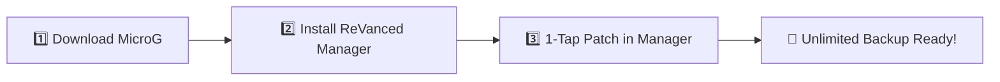

# 📱 Complete Installation & Setup Guide

This guide walks you through setting up **Unlimited Google Photos Storage & Security Hardening** on your Android device.

---

## ⚡ Choose Your Preferred Method:

| Method | Best For | Prerequisites | Time |
| :--- | :--- | :--- | :---: |
| **[Method 1: Phone-Only (ReVanced Manager)](#method-1-phone-only-setup-via-revanced-manager-recommended)** | Sideloading directly on your phone without a computer | Android Phone | ~3 Mins |
| **[Method 2: Standalone 1-Click Builder](#method-2-standalone-1-click-patch-tool-pc--termux)** | Fast building on PC (Windows/Mac/Linux) or Termux | Python 3 | ~10 Secs |

---

## Method 1: Phone-Only Setup via ReVanced Manager (Recommended)



### 1️⃣ Step 1: Install MicroG GmsCore (For Google Sign-In)
Because the modified app is decoupled from official Google Play Services, it needs MicroG to log into your Google Account:
1. Download the latest MicroG APK on your phone:  
   👉 **[Download MicroG APK (Direct Link)](https://github.com/ReVanced/GmsCore/releases/latest)**
2. Tap the file in your notifications or Downloads folder to install it.
3. Open **MicroG Settings** from your app drawer:
   - Tap **Account** > **Add Google Account** and sign in.
   - Go to phone **Settings > Apps > MicroG > Battery** and set it to **Unrestricted** (so photo backups don't pause).

### 2️⃣ Step 2: Install ReVanced Manager & Configure Custom Sources
1. Download and install **ReVanced Manager** on your phone:  
   👉 **[Download ReVanced Manager APK (Direct Link)](https://github.com/ReVanced/revanced-manager/releases/latest)**
2. To get our hardened security fixes automatically:
   - Open ReVanced Manager > tap **Settings (gear icon)** > tap **Sources** (or *Alternative Sources*).
   - Copy and paste these exact values:
     - **Patches organization**:
       ```text
       shohagranasuvo
       ```
     - **Patches source**:
       ```text
       Google_Photos_Unlimited
       ```
   - Close and restart ReVanced Manager.

### 3️⃣ Step 3: Patch Google Photos & Install
1. Download the supported clean Google Photos APK on your phone:  
   👉 **[Download Google Photos APK (Working APKMirror Link)](https://www.apkmirror.com/apk/google-inc/photos/google-photos-7-97-0-1003324405-release/)**  
   *(Make sure to download the standard **APK** file, not the "Bundle" variant).*
2. Open **ReVanced Manager**:
   - Tap **Patcher** at the bottom navigation bar.
   - Tap **Select an application** > tap **Storage** (bottom right).
   - Select the downloaded Google Photos APK.
3. Tap the blue **Patch** button (bottom right) and wait ~1 minute.
4. Tap **Install**!

---

## Method 2: Standalone 1-Click Patch Tool (PC & Termux)

If you have a computer (Windows, Mac, or Linux) or use Termux on Android, you can build your remediated APK in **5 seconds** with **1 command**:

### 1️⃣ Step 1: Download the Patch Kit
Download the official patch kit from GitHub Releases:  
👉 **[Download google-photos-unlimited-patch-v7.45.0.zip](https://github.com/shohagranasuvo/Google_Photos_Unlimited/releases/download/v7.45.0-remediated/google-photos-unlimited-patch-v7.45.0.zip)**

### 2️⃣ Step 2: Extract & Add Clean APK
1. Extract the downloaded ZIP archive.
2. Download the clean Google Photos APK from:  
   👉 **[Google Photos Base APK (Working APKMirror Link)](https://www.apkmirror.com/apk/google-inc/photos/google-photos-7-97-0-1003324405-release/)**  
   *(Save it inside the extracted folder as `base.apk`).*

### 3️⃣ Step 3: Run the Patcher
In your terminal (or Command Prompt / PowerShell / Termux), run:
```bash
python3 patch.py base.apk
```

The script will automatically:
- ✅ Apply `usesCleartextTraffic="false"` (SEC-01).
- ✅ Disable ADB backup extraction and restore risks (SEC-02).
- ✅ Unexport internal content providers (SEC-03).
- ✅ Suppress verbose startup Logcat dumps (SEC-04).
- ✅ Align to 4-byte boundaries and self-sign with a local key.

Your ready-to-install file **`GooglePhotos_Unlimited_Remediated.apk`** is created in the same folder! Transfer it to your phone and install.

---

## 🎉 How to Confirm Unlimited Storage:

1. Open your newly installed **Google Photos** app.
2. Sign in with your Google account via MicroG.
3. Tap your **Profile icon** at the top right > tap **Manage storage**.
4. You will see the official Pixel banner:  
   **"📱 This Pixel XL can back up unlimited photos & videos at no charge"**

---

## 💡 Simple Troubleshooting & FAQs

- **"App not installed" error?**  
  If you have an older modded Photos app installed with a different key, uninstall it first, then install the new one. *(Your local photos on your device will NOT be deleted).*
- **"Manage Google Account" button crashes?**  
  This is a known cosmetic bug. To manage your Google account settings, simply visit [myaccount.google.com](https://myaccount.google.com) in your browser.
- **Photos not backing up automatically?**  
  Go to your phone's **Settings > Apps > Google Photos > Battery** and set it to **Unrestricted**.

---

<details>
<summary>🛠️ <b>Advanced Method: Install via ADB (For Developers)</b></summary>

```bash
# Verify file digest
sha256sum GooglePhotos_Unlimited_Remediated.apk

# Install via USB debugging
adb install -r GooglePhotos_Unlimited_Remediated.apk

# Check package manager flags
adb shell dumpsys package app.revanced.android.photos | grep -E "versionName|flags"
```

</details>
