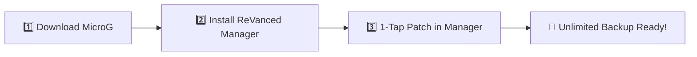

# 📱 Complete Installation & Setup Guide

This guide walks you through setting up **Unlimited Google Photos Storage & Security Hardening** on your Android device.

---

## ⚡ Choose Your Preferred Method:

| Method | Where It Runs | PC Needed? | Ease |
| :--- | :--- | :---: | :---: |
| **[Method 1: Phone-Only via ReVanced Manager](#method-1-phone-only-setup-via-revanced-manager)** | Directly on Android Phone | ❌ No | ⭐⭐⭐⭐⭐ (Easiest UI) |
| **[Method 2: Phone-Only via Termux 1-Click Builder](#method-2-phone-only-via-termux-1-click-patcher)** | Directly on Android Phone | ❌ No | ⭐⭐⭐⭐⭐ (Fastest on Phone) |
| **[Method 3: 1-Click Patch Tool on PC](#method-3-1-click-patch-tool-pc--mac--linux)** | Windows / Mac / Linux |  Yes | ⭐⭐⭐⭐⭐ (Fastest on PC) |

---

## ⚠️ Important: Choosing the Correct APK (Avoid Bundles!)

> [!CAUTION]
> **DO NOT DOWNLOAD A "BUNDLE" (APKM)!**
> On APKMirror, there are two types of files:
> - ❌ **BUNDLE (APKM)**: Split packages that ReVanced and patch tools cannot patch.
> - ✅ **APK (Universal / nodpi)**: A standalone single package.
>
> 👉 **[Download Working Google Photos APK on APKMirror](https://www.apkmirror.com/apk/google-inc/photos/google-photos-7-97-0-1003324405-release/)**  
> *(Scroll down to "Download", look for the row with the green **APK** badge, and download).*

---

## Method 1: Phone-Only Setup via ReVanced Manager



### 1️⃣ Step 1: Install MicroG GmsCore (For Google Sign-In)
Because the modified app is decoupled from official Google Play Services, it needs MicroG to log into your Google Account:
1. Download the latest MicroG APK on your phone:  
   👉 **[Download MicroG APK (Direct Link)](https://github.com/ReVanced/GmsCore/releases/latest)**
2. Tap the file in your notifications or Downloads folder to install it.
3. Open **MicroG Settings** from your app drawer:
   - Tap **Account** > **Add Google Account** and sign in.
   - Go to phone **Settings > Apps > MicroG > Battery** and set it to **Unrestricted** (so photo backups don't pause).

### 2️⃣ Step 2: Install ReVanced Manager & Configure Custom Sources
1. Download and install **ReVanced Manager** on your phone:  
   👉 **[Download ReVanced Manager APK (Direct Link)](https://github.com/ReVanced/revanced-manager/releases/latest)**
2. To get our hardened security fixes automatically:
   - Open ReVanced Manager > tap **Settings (gear icon)** > tap **Sources** (or *Alternative Sources*).
   - Copy and paste these exact values:
     - **Patches organization**:
       ```text
       shohagranasuvo
       ```
     - **Patches source**:
       ```text
       Google_Photos_Unlimited
       ```
   - Close and restart ReVanced Manager.

### 3️⃣ Step 3: Patch Google Photos & Install
1. Download the clean Google Photos **APK** (ensure it is the APK row, not Bundle):  
   👉 **[Google Photos APK Download](https://www.apkmirror.com/apk/google-inc/photos/google-photos-7-97-0-1003324405-release/)**
2. Open **ReVanced Manager**:
   - Tap **Patcher** at the bottom navigation bar.
   - Tap **Select an application** > tap **Storage** (bottom right).
   - Select the downloaded Google Photos APK.
3. Tap the blue **Patch** button (bottom right) and wait ~1 minute.
4. Tap **Install**!

---

## Method 2: Phone-Only via Termux (1-Click Patcher)

If you don't want to use ReVanced Manager, you can build your remediated APK right on your Android phone using **Termux** in 30 seconds:

1. Install **[Termux](https://github.com/termux/termux-app/releases/latest)** on your phone.
2. Download our patch kit:  
   👉 **[Download google-photos-unlimited-patch-v7.45.0.zip](https://github.com/shohagranasuvo/Google_Photos_Unlimited/releases/download/v7.45.0-remediated/google-photos-unlimited-patch-v7.45.0.zip)**
3. Download the clean [Google Photos APK](https://www.apkmirror.com/apk/google-inc/photos/google-photos-7-97-0-1003324405-release/) into your phone's **Downloads** folder and name it `base.apk`.
4. Open Termux and run these commands:
   ```bash
   termux-setup-storage
   pkg update && pkg install python -y
   cd ~/storage/downloads
   unzip google-photos-unlimited-patch-v7.45.0.zip
   python patch.py base.apk
   ```
5. Done! The patched APK **`GooglePhotos_Unlimited_Remediated.apk`** will appear in your Downloads folder. Tap it in your phone's file manager to install!

---

## Method 3: 1-Click Patch Tool (PC / Mac / Linux)

If you have a computer, you can build your remediated APK in **5 seconds** with **1 command**:

1. Download the patch kit from our latest release:  
   👉 **[Download google-photos-unlimited-patch-v7.45.0.zip](https://github.com/shohagranasuvo/Google_Photos_Unlimited/releases/download/v7.45.0-remediated/google-photos-unlimited-patch-v7.45.0.zip)**
2. Extract the ZIP file on your computer.
3. Download clean Google Photos [APK](https://www.apkmirror.com/apk/google-inc/photos/google-photos-7-97-0-1003324405-release/) and place it in the folder as `base.apk`.
4. Run:
   ```bash
   python3 patch.py base.apk
   ```
5. The script injects all security fixes, aligns, and signs **`GooglePhotos_Unlimited_Remediated.apk`**. Transfer it to your phone and install!

---

## 🎉 How to Confirm Unlimited Storage:

1. Open your newly installed **Google Photos** app.
2. Sign in with your Google account via MicroG.
3. Tap your **Profile icon** at the top right > tap **Manage storage**.
4. You will see the official Pixel banner:  
   **"📱 This Pixel XL can back up unlimited photos & videos at no charge"**

---

## 💡 Simple Troubleshooting & FAQs

- **"App not installed" error?**  
  If you have an older modded Photos app installed with a different key, uninstall it first, then install the new one. *(Your local photos on your device will NOT be deleted).*
- **"Manage Google Account" button crashes?**  
  This is a known cosmetic bug. To manage your Google account settings, simply visit [myaccount.google.com](https://myaccount.google.com) in your browser.
- **Photos not backing up automatically?**  
  Go to your phone's **Settings > Apps > Google Photos > Battery** and set it to **Unrestricted**.
